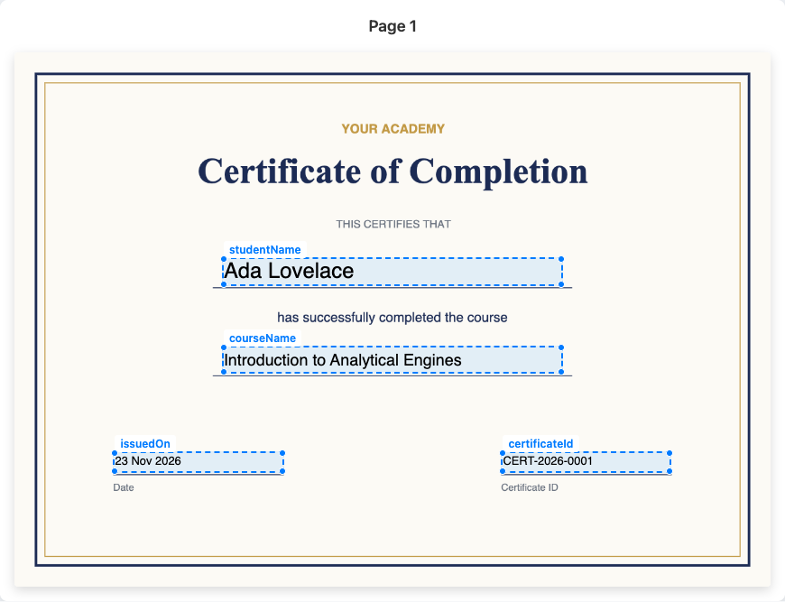

# PDF Template Builder + Engine

**Place fields on any PDF visually, then fill it from JSON**, in the browser, on serverless, or in Node.js.

**[▶ Live demo](https://jyothis-dev.github.io/pdf-npm-package/)**



| Package | What it does | |
|---|---|---|
| [`@jyothiswarup/pdf-template-builder`](./pdf-template-builder) | React drag-and-drop editor: upload a PDF, place fields, export a JSON schema | [](https://www.npmjs.com/package/@jyothiswarup/pdf-template-builder) |
| [`@jyothiswarup/pdf-template-engine`](./frontend%202) | Fills the PDF with your data using that schema (`fillPdf` / `generatePDF`) | [](https://www.npmjs.com/package/@jyothiswarup/pdf-template-engine) |

```bash
npm install @jyothiswarup/pdf-template-builder @jyothiswarup/pdf-template-engine
```

```ts
import { fillPdf } from '@jyothiswarup/pdf-template-engine';

const pdf = await fillPdf(templateBytes, schema, { studentName: 'Ada Lovelace' });
```

Typical uses: course certificates, invoices, event tickets, ID badges, offer letters. Any document with a fixed design where only the data changes.

## Repository layout

| Folder | |
|---|---|
| `pdf-template-builder/` | Builder package source |
| `frontend 2/` | Engine package source |
| `demo/` | The live demo (Vite + React), deployed to GitHub Pages |
| `backend-test/` | Example Express server that fills PDFs with the engine |

## Contributing

Issues and pull requests are welcome. Feature requests (custom fonts, colours, alignment, images) help decide what comes next.

MIT © Jyothiswarup E V
