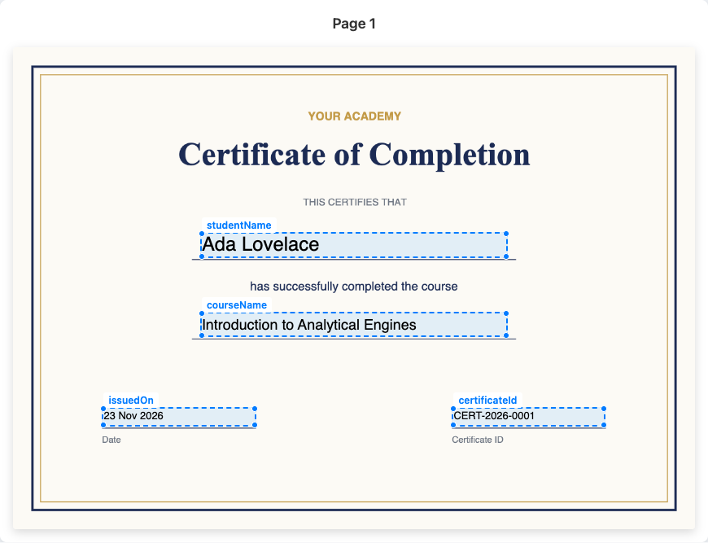

# @jyothiswarup/pdf-template-engine

**Fill any existing PDF from JSON.** Place text at exact positions on certificates, invoices, tickets and forms. Works in **Node.js, the browser, and serverless / edge** runtimes.

[](https://www.npmjs.com/package/@jyothiswarup/pdf-template-engine)
[](https://github.com/jyothis-dev/pdf-npm-package/blob/main/LICENSE)

**[▶ Try the live demo](https://jyothis-dev.github.io/pdf-npm-package/)**: drag fields onto a PDF and generate it in your browser.



Don't want to work out coordinates by hand? Use the companion visual editor, [`@jyothiswarup/pdf-template-builder`](https://www.npmjs.com/package/@jyothiswarup/pdf-template-builder). Drop it into a React app, drag boxes onto your PDF, and export the schema this package consumes.

## Why

- **Use the PDF you already have.** Design it in Canva, Figma, Word or InDesign, then fill it. There's no template language to learn.
- **Runs anywhere.** `fillPdf()` works on raw bytes with no file-system access, so it runs in browsers, Vercel and Netlify functions, Cloudflare Workers and Node.js.
- **Accurate placement.** Text lands inside the box you drew, on rotated pages and pages with crop boxes too.
- **Small and typed.** Its only dependency is [pdf-lib](https://pdf-lib.js.org), and it ships TypeScript types.

## Install

```bash
npm install @jyothiswarup/pdf-template-engine
```

## Quick start

### Browser, serverless or Node.js: `fillPdf()`

```ts
import { fillPdf } from '@jyothiswarup/pdf-template-engine';

const fields = [
  { key: 'studentName', x: 231, y: 228, width: 380, height: 32, fontSize: 24 },
  { key: 'issuedOn',    x: 110, y: 444, width: 190, height: 24, fontSize: 13 },
];

const template = await fetch('/certificate.pdf').then((r) => r.arrayBuffer());
const pdfBytes = await fillPdf(template, fields, {
  studentName: 'Ada Lovelace',
  issuedOn: '23 Nov 2026',
});

// e.g. show or download it in the browser
const url = URL.createObjectURL(new Blob([pdfBytes as BlobPart], { type: 'application/pdf' }));
```

### Node.js, from and to files: `generatePDF()`

```ts
import { generatePDF } from '@jyothiswarup/pdf-template-engine';

await generatePDF({
  templatePath: './templates/certificate.pdf',
  outputPath: './output/ada.pdf',
  fields,
  data: { studentName: 'Ada Lovelace', issuedOn: '23 Nov 2026' },
});
```

CommonJS works too: `const { generatePDF, fillPdf } = require('@jyothiswarup/pdf-template-engine')`.

### Generate many PDFs (e.g. a certificate for every student)

```ts
import { readFile, writeFile } from 'fs/promises';
import { fillPdf } from '@jyothiswarup/pdf-template-engine';

const template = await readFile('./certificate.pdf');
for (const student of students) {
  const pdf = await fillPdf(template, fields, student);
  await writeFile(`./out/${student.certificateId}.pdf`, pdf);
}
```

### An API route (Next.js App Router)

```ts
// app/api/certificate/route.ts
import { fillPdf } from '@jyothiswarup/pdf-template-engine';
import fields from './schema.json';

export async function POST(req: Request) {
  const data = await req.json();
  const template = await fetch(new URL('/certificate.pdf', req.url)).then((r) => r.arrayBuffer());
  const pdf = await fillPdf(template, fields, data);
  return new Response(pdf as BodyInit, { headers: { 'Content-Type': 'application/pdf' } });
}
```

## API

### `fillPdf(pdf, fields, data): Promise<Uint8Array>`

Fills a template in memory and returns the new PDF. It has no Node.js dependencies.

| Param | Type | |
|---|---|---|
| `pdf` | `Uint8Array \| ArrayBuffer` (Node `Buffer` works) | The template PDF |
| `fields` | `PDFField[]` | Where to put each value |
| `data` | `Record<string, string \| number>` | Values keyed by field `key` |

### `generatePDF(options): Promise<void>` (Node.js only)

Reads `templatePath`, fills it, and writes to `outputPath` (creating folders as needed).

| Option | Type |
|---|---|
| `templatePath` | `string` |
| `outputPath` | `string` |
| `fields` | `PDFField[]` |
| `data` | `PDFData` |

### `PDFField`

| Property | Type | Default | Description |
|---|---|---|---|
| `key` | `string` | required | Name of the value in `data` |
| `x` | `number` | required | Left edge of the box, in points from the **left** of the page |
| `y` | `number` | required | Top edge of the box, in points from the **top** of the page |
| `width` | `number` | | Box width in points |
| `height` | `number` | | Box height in points. If set, text is **vertically centered** in the box; otherwise its top aligns with `y` |
| `fontSize` | `number` | `12` | Font size in points |
| `page` | `number` | `1` | 1-indexed page number |

## Coordinate system

Coordinates are in **PDF points** (1 pt = 1/72 inch) with the origin at the **top-left** of the page as you see it in a viewer. That's the same convention as screen coordinates, and it's what `@jyothiswarup/pdf-template-builder` exports. The engine handles the PDF's bottom-left origin, crop box offsets and page rotation for you.

| Page size | Width × height (pt) |
|---|---|
| A4 portrait | 595 × 842 |
| A4 landscape | 842 × 595 |
| US Letter | 612 × 792 |

## Errors

Both functions reject with a descriptive `Error` when:

- a field's value is missing from `data`: `Missing required field values: studentName`
- a coordinate, size or page number is invalid: `Invalid x coordinate for field 'name': -1`
- the page doesn't exist: `Page 3 does not exist in the PDF for field 'name'`
- the template can't be read or parsed: `Template PDF not found: …` or `Failed to load PDF template: …`

## Current limitations

Text is drawn in Helvetica, in black, and left-aligned on a single line. Custom fonts, colours, alignment, wrapping and images are on the roadmap. [Open an issue](https://github.com/jyothis-dev/pdf-npm-package/issues) to tell me which you need most.

## Development

```bash
npm install
npm run build      # dist/ (ESM + CJS + types)
npm run typecheck
```

## License

MIT © Jyothiswarup E V
