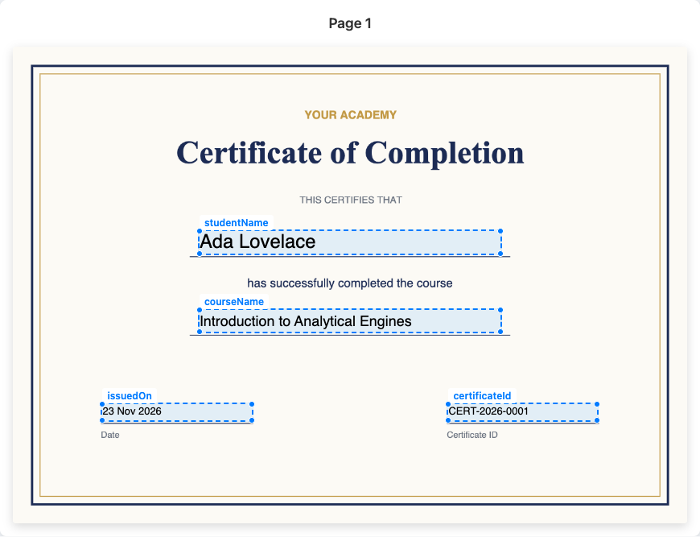

# @jyothiswarup/pdf-template-builder

**A drag-and-drop PDF field mapper for React.** Upload any PDF, place text fields on it visually, and export a JSON schema. Then fill the PDF with real data using [`@jyothiswarup/pdf-template-engine`](https://www.npmjs.com/package/@jyothiswarup/pdf-template-engine), in the browser or on your server.

[](https://www.npmjs.com/package/@jyothiswarup/pdf-template-builder)
[](https://github.com/jyothis-dev/pdf-npm-package/blob/main/LICENSE)

**[▶ Try the live demo](https://jyothis-dev.github.io/pdf-npm-package/)**



Good for certificates, invoices, tickets, badges, offer letters, and any document where the design is fixed and only the data changes.

## Features

- **Click to add, drag to move, drag corners to resize.** Positions are what you see: the generated PDF matches the boxes.
- **Live preview** of sample values inside each box, at the real font size.
- **Multi-page PDFs**, responsive layout, and accurate on any screen size or zoom level.
- **Exports a plain JSON schema** (PDF points, top-left origin) that you can store in a database and reuse.
- **Generate PDFs in the browser** (no server needed) or post to your own API.
- TypeScript types and a `"use client"` build, so it works in the Next.js App Router.

## Install

```bash
npm install @jyothiswarup/pdf-template-builder @jyothiswarup/pdf-template-engine
```

Requires React 18 or newer. PDF rendering uses [PDF.js](https://mozilla.github.io/pdf.js/), which is loaded automatically from cdnjs.

## Quick start

```tsx
import { PDFTemplateBuilder } from '@jyothiswarup/pdf-template-builder';
import '@jyothiswarup/pdf-template-builder/styles';
import { fillPdf } from '@jyothiswarup/pdf-template-engine';

export function CertificateDesigner() {
  return (
    <PDFTemplateBuilder
      onSchemaExport={(schema) => saveToDatabase(schema)}
      onGenerate={async (schema, data, file) => {
        // Fill the PDF right in the browser
        const bytes = await fillPdf(await file.arrayBuffer(), schema, data);
        window.open(URL.createObjectURL(new Blob([bytes as BlobPart], { type: 'application/pdf' })));
      }}
    />
  );
}
```

Then fill it from your backend with the saved schema:

```ts
import { generatePDF } from '@jyothiswarup/pdf-template-engine';

await generatePDF({
  templatePath: './certificate.pdf',
  outputPath: './out/ada.pdf',
  fields: schema, // exported by the builder
  data: { studentName: 'Ada Lovelace', courseName: 'Analytical Engines' },
});
```

### Edit an existing template

```tsx
<PDFTemplateBuilder
  pdfFile={templateFile}     // File: loaded immediately
  initialSchema={savedSchema} // fields placed on the first PDF that loads
  initialData={{ studentName: 'Ada Lovelace' }} // sample values for the preview
  onSchemaChange={setSchema}  // called on every add / move / resize / delete
/>
```

### Send to your API instead

```tsx
<PDFTemplateBuilder apiEndpoint="/api/generate-pdf" />
```

This POSTs `multipart/form-data` with `pdf` (the file), `schema` (JSON) and `data` (JSON), then downloads the PDF your endpoint returns.

## The schema

```json
[
  { "key": "studentName", "x": 231, "y": 228, "width": 380, "height": 32, "fontSize": 24, "page": 1 }
]
```

| Property | Description |
|---|---|
| `key` | Name of the value to insert |
| `x`, `y` | Top-left corner of the box, in PDF points from the page's top-left corner |
| `width`, `height` | Box size in points. The engine vertically centers text in the box |
| `fontSize` | Font size in points |
| `page` | 1-indexed page number |

Coordinates are stored in **PDF points**, not screen pixels, so a schema stays correct however large the page is displayed.

## `<PDFTemplateBuilder>` props

| Prop | Type | Description |
|---|---|---|
| `pdfFile` | `File \| null` | PDF to load on mount (users can still upload another) |
| `initialSchema` | `SchemaField[]` | Fields to place on the first PDF that loads |
| `initialData` | `Record<string, string \| number>` | Sample values shown in the boxes |
| `onSchemaChange` | `(schema) => void` | Called whenever fields change |
| `onSchemaExport` | `(schema) => void` | Called by **Export JSON Schema** (default: downloads a `.json` file) |
| `onGenerate` | `(schema, data, file) => Promise<void>` | Called by **Generate PDF** |
| `apiEndpoint` | `string` | Used by **Generate PDF** when `onGenerate` isn't given |
| `mode` | `'builder' \| 'viewer'` | `'viewer'` hides the field editor |
| `className` | `string` | Extra class on the root element |

## Building your own layout

The building blocks are exported too: `PDFUploader`, `PDFViewer`, `FieldMapper`, `Toolbar`, the `usePDF()` hook, and `exportSchema()` / `downloadSchema()`. In these components a field's `x`, `y`, `width` and `height` are in PDF points, and `page` is 0-indexed. `exportSchema()` converts pages to the 1-indexed schema.

```tsx
import { usePDF, PDFViewer, PDFUploader, exportSchema, type PDFField } from '@jyothiswarup/pdf-template-builder';

function MyEditor() {
  const { pages, loadPDF, getCanvasRef } = usePDF();
  const [fields, setFields] = useState<PDFField[]>([]);
  // ...
  return (
    <>
      <PDFUploader onFileSelect={loadPDF} />
      <PDFViewer
        pages={pages}
        fields={fields}
        selectedFieldId={null}
        onFieldSelect={() => {}}
        onFieldUpdate={(id, u) => setFields((fs) => fs.map((f) => (f.id === id ? { ...f, ...u } : f)))}
        onFieldDelete={(id) => setFields((fs) => fs.filter((f) => f.id !== id))}
        onFieldAdd={(page, x, y) =>
          setFields((fs) => [...fs, { id: crypto.randomUUID(), key: 'name', x, y, width: 150, height: 20, page, fontSize: 12 }])
        }
        getCanvasRef={getCanvasRef}
      />
      <pre>{JSON.stringify(exportSchema(fields, pages), null, 2)}</pre>
    </>
  );
}
```

## Styling

Import the default styles once: `import '@jyothiswarup/pdf-template-builder/styles'`. Every element has a stable class name (`.pdf-template-builder-sidebar`, `.field-box`, `.field-label`, `.toolbar-button`, …) that you can override in your own CSS.

## Upgrading from 0.1.x

Version 0.1 converted screen pixels to PDF points incorrectly whenever the page was shrunk to fit the screen, so generated text landed in the wrong place. Upgrade both packages together and **re-export schemas saved with 0.1.x**:

```bash
npm install @jyothiswarup/pdf-template-builder@latest @jyothiswarup/pdf-template-engine@latest
```

## License

MIT © Jyothiswarup E V. Issues and pull requests are welcome on [GitHub](https://github.com/jyothis-dev/pdf-npm-package).
